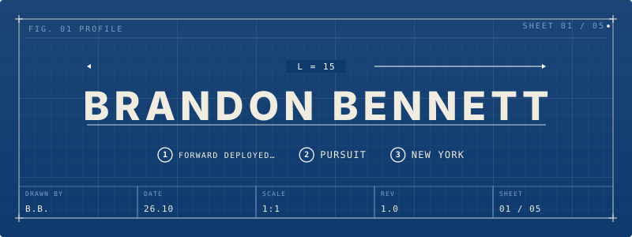
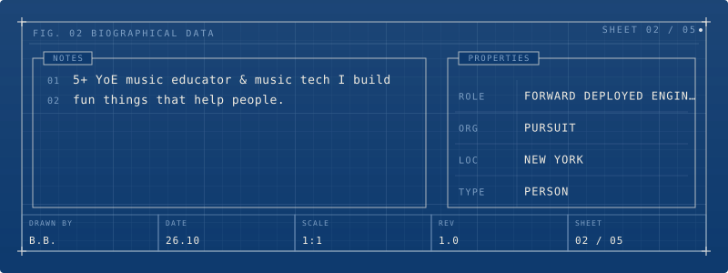
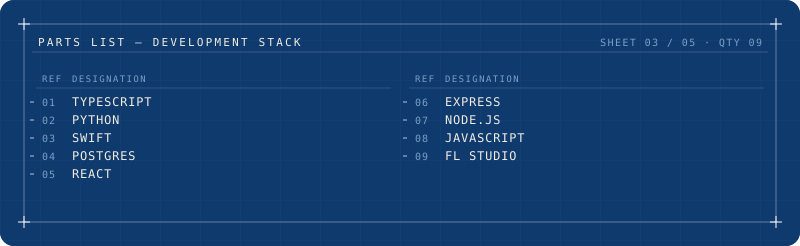
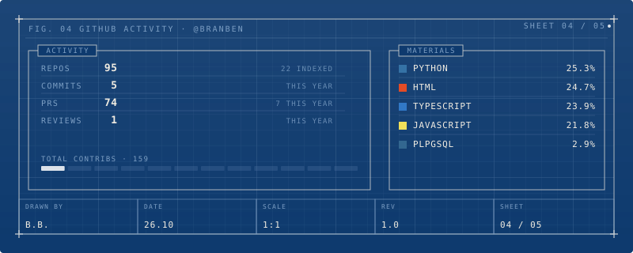
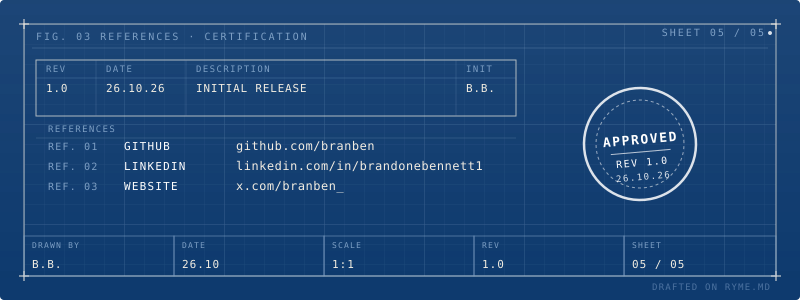

  

  
  
  
  

---

  

---

### 🎵 Sound Royale — Music Battle Platform

> Building the future of competitive music. A full-stack platform where artists compete in real-time battles, fans vote and the best tracks rise to the top.

.full-stack platform with real-time battle mechanics, payment integration (Stripe), AI-powered judging (OpenAI, Anthropic, Google Gemini), and a React frontend. Features include bracket-style tournaments, fan voting with virtual currency, live leaderboards, and social sharing.

**Frontend:** 110+ unit tests (Vitest), 0 TypeScript errors, component library with Glassmorphism/Minimalism/Bento Grid styles
**Backend:** Django REST Framework, 70+ API endpoints, JWT auth, Stripe webhooks, OpenAI integration

*Actively developing — targeting launch in 2026.*

---

### 💀 [Worst Day Ever](https://github.com/branben/worst-day-ever-skill) — Adversarial Stress Testing

> Break your app before your users do. A skill that generates worst-case user flows, runs them in a sandbox, and produces a severity-ranked disaster report.

**5-step pipeline:** MAP → GENERATE → SANDBOX → EXECUTE → REPORT

**8 attack dimensions:** Input Boundary, State Machine Torture, Temporal/Timing, AuthN/Z Shadow, Data Integrity Cascade, Concurrent Load, External Dependency Failure, Brownfield Mining

**6 safeguards:** No real data, no secrets, sandboxed execution, no external calls, bounded duration, no mutation

Supports greenfield (API specs) and brownfield (production logs) modes. Built on semantic anchoring — named categories force structured LLM coverage. Produces a severity-ranked disaster report with resilience score.

*Usage: clone the repo, read `SKILL.md`, paste the assessment prompt into any agent.*

---

### 🔌 [Worst Day Ever MCP](https://github.com/branben/wde-mcp-server) — MCP Server

> Exposes the Worst Day Ever skill as an MCP server via SEP-2640 skills extension.

Built on `rmcp` (Rust MCP SDK) with SEP-2640 Skills extension. Exposes the skill as a skill (via `io.modelcontextprotocol/skills`), a tool (`worst_day_ever_assess`), and resources (8 dimension files).

**Two transports:** stdio (`cargo run --bin wde-mcp-stdio`) and HTTP (`cargo run --bin wde-mcp-http`, `127.0.0.1:3001/mcp`)

Includes Python and Rust client examples. Tests: `cargo test` + `cargo clippy --all-targets --all-features -- -D warnings`.

---

### 🏫 [School Core](https://github.com/branben/school-core) — Agent Development Framework

> Route, score, review, and grow AI agents through practice — not prompt-chaining.

A developmental framework where students grow through practice, feedback, challenge, and rest.

**Key architecture:**
- **Roles over prompts** — persistent personas (Student / Teacher / Principal / Janitor) with point-gated progression (0-24 → 25-49 → 50-74 → 75+)
- **Compiler before critic** — execute code first, LLM-as-judge last
- **Adversarial review** — two-judge (CTO + COO) on every output
- **Difficulty-adjusted EMA scoring** for growth measurement

**942 tests passing, 15 skipped.** Uses `orca dispatch` and `FirstMate` for crew spawning into Orca worktrees.

---

### 🛠️ [School Core Skills](https://github.com/branben/school-core-skills) — 16 Agent Skills

> A two-loop SDLC in 16 installable agent skills — epic to tickets, ticket to merged PR.

**Install:** `npx skills add branben/school-core-skills`

**Outer loop** (human-driven planning): `grill-me → vision → nose-up → to-prd → to-spec → to-tickets`

**Inner loop** (build): `Prime → Plan → Implement → Validate → Review → PR`

**16 skills total:** `grill-me`, `nose-up`, `spawn-whymage`, `vision`, `to-prd`, `to-spec`, `to-tickets`, `html-diagram`, `html-plan`, `html-wireframe`, `html-prototype`, `html`, `design-artifact`, `plannotator-guide`, `round-based-hook`, `think-tank`, `chunked-writing`, `implement`

Skills assembled from mattpocock/skills, kunchenguid/vision, plannotator/effective-html, and plannotator/guides.

---

### 🤖 [MCP Rust SDK](https://github.com/modelcontextprotocol/rust-sdk) — Contributor

> Merged: JSON Schema 2020-12 alignment for tool schemas.

**PR [#895](https://github.com/modelcontextprotocol/rust-sdk/pull/895) — SEP-2106: Relax `outputSchema` type gate** ✅ Merged
- Split `validate_and_strip` into input/output variants: `inputSchema` keeps `type: "object"`; `outputSchema` now accepts any JSON Schema root type
- Updated `with_output_schema` docs
- 17 new tests for primitives, arrays, compositions, unit type, `Json<T>`, `ToolBase`, cache correctness, and input rejection
- Merged in v0.24.0

---

### ⚡ [OmniRoute](https://github.com/diegosouzapw/OmniRoute) — Open Source Contributor

> One endpoint. 160+ providers. 50+ free. Connect Claude Code, Codex, Cursor, Cline & Copilot to free Claude/GPT/Gemini.

Active contributor to the [OmniRoute](https://github.com/diegosouzapw/OmniRoute) project (5.7k+ stars). The unified AI proxy/router that makes advanced AI accessible to everyone.

**Contributions:**
- 🔒 **[#2958](https://github.com/diegosouzapw/OmniRoute/pull/2958) — MCP Scope Enforcement Fix** — Fixed critical bug where dynamic tool groups (memory, skills, plugins, compression, gamification) were blocked when scope enforcement was enabled. Reordered guard logic in `evaluateToolScopes()` and added inline scope support to 33 dynamic tool definitions across 5 files. Credited in v3.8.8 CHANGELOG.
- 🔌 **[#2959](https://github.com/diegosouzapw/OmniRoute/pull/2959) — Notion MCP Context Source** — 6 MCP tools (`notion_search`, `notion_list_databases`, `notion_query_database`, `notion_read`, `notion_append_blocks`, `notion_get_database`), dashboard UI tab, read/write scope separation, 20 unit tests
- 🔧 **[#10575](https://github.com/diegosouzapw/OmniRoute/pull/10575) — make GitHub skill tools discoverable through omniroute_tool_search** — Fixed critical bug where the 3 GitHub skill tools were registered but invisible to `omniroute_tool_search`. Corrected `TOTAL_MCP_TOOL_COUNT` and added missing tool entries.
- 🏗️ **[#10039](https://github.com/diegosouzapw/OmniRoute/pull/10039) — combo-lane awareness + activation UX + MCP visibility (Wave 2 of #9654)** — Extends per-connection virtual admission lanes: fan-out awareness, operator activation control, lane state API.
- 🐛 **[#10322](https://github.com/diegosouzapw/OmniRoute/pull/10322) — fix(chat-body-admission): process-wide budget (#10110)** — Fixes LRU/TTL eviction orphaning live leases from Wave 1's per-connection admission lanes.
- 📡 **[#9940](https://github.com/diegosouzapw/OmniRoute/pull/9940) — fix: per-connection virtual admission lanes (#9654)** — Wave 1: per-connection virtual admission lanes for agentic workloads, worst-day-ever analysis, failing-test-first.
- 📝 **[#3077](https://github.com/diegosouzapw/OmniRoute/pull/3077) — feat(observability): add Obsidian context source with 24 MCP tools** — Obsidian via Local REST API plugin, 24 tools scoped `read:obsidian`/`write:obsidian`, follows Notion context source pattern.
- 🆕 **[#15983](https://github.com/diegosouzapw/OmniRoute/pull/15983) — feat(mcp): add 2026-07-28 spec-compliant v2 server sidecar** (open) — Parallel MCP server surface implementing the 2026-07-28 spec revision: explicit `server/discover` RPC, `resultType` discriminator, cacheable list responses, `_meta` client identity, `outputSchema`.
- 🐛 **[#15498](https://github.com/diegosouzapw/OmniRoute/pull/15498) — fix(pii): stop redacting code syntax as IPv6** (merged) — Fixed bare `::` regex alternative in `pii_sanitizer.ts` that corrupted Python slices, Haskell/Scala type annotations when PII sanitization was on.

---

### ⚡ [Orca](https://github.com/stablyai/orca) — Open Source Contributor

> Agent terminal renderer. Build CLI engine with xterm.js and PTY orchestration.

Active contributor to the [Orca](https://github.com/stablyai/orca) project (10.3k+ stars). CLI engine powering agents like Codex, Claude Code, and OpenCode in the terminal.

**Contributions:**
- 🖥️ **[#6758](https://github.com/stablyai/orca/pull/6758) — Fix TUI display artifacts over SSH** — Detects in-place rewrites on background-queued output during idle, then forces a viewport refresh on first foreground chunk. Closes stale renderer-cell bug across agent TUIs.
- 🩹 **[#6645](https://github.com/stablyai/orca/pull/6645)** — fix-maybe-win - fix escaped windows path being converted to an absolute path by winPath
- 🐳 **[#6671](https://github.com/stablyai/orca/pull/6671) — Support docker run outside git directory context**
- 🔧 **[#7862](https://github.com/stablyai/orca/pull/7862) — fix(automations): deliver Hermes prompts via native query** — Hermes automations now use `hermes chat --query=<prompt> --tui` native startup contract; prompt transported outside shell history, normalized across wrappers.

---

### 💎 [OmniRoute Sync](https://github.com/branben/obsidian-omniroute-sync) — Obsidian Community Plugin

> Sync your vault between desktop and mobile over Tailscale. No cloud services required.

A standalone Obsidian community plugin for vault-to-vault sync over Tailscale. Smart frontmatter filtering, backlink-aware prioritization, and end-to-end push verification.

**Features:**
- 🔀 Bidirectional sync over Tailscale (no cloud)
- 🏷️ Smart frontmatter filtering (skips private/personal/draft notes)
- 🔗 Backlink-aware prioritization (connected notes sync first)
- ✅ End-to-end push verification (mtime confirmation)
- 🤝 Conflict resolution (keep local/remote/keep-both)
- 🐛 Per-category debug logging with in-plugin viewer
- 🛡️ Rate limiting (120 req/min per IP)

---

  

---

  

---

  

